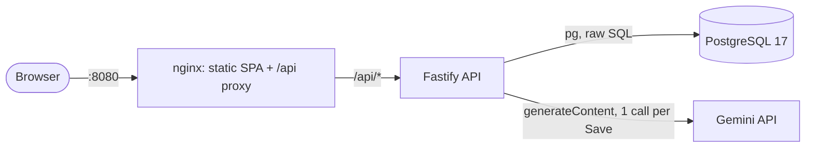
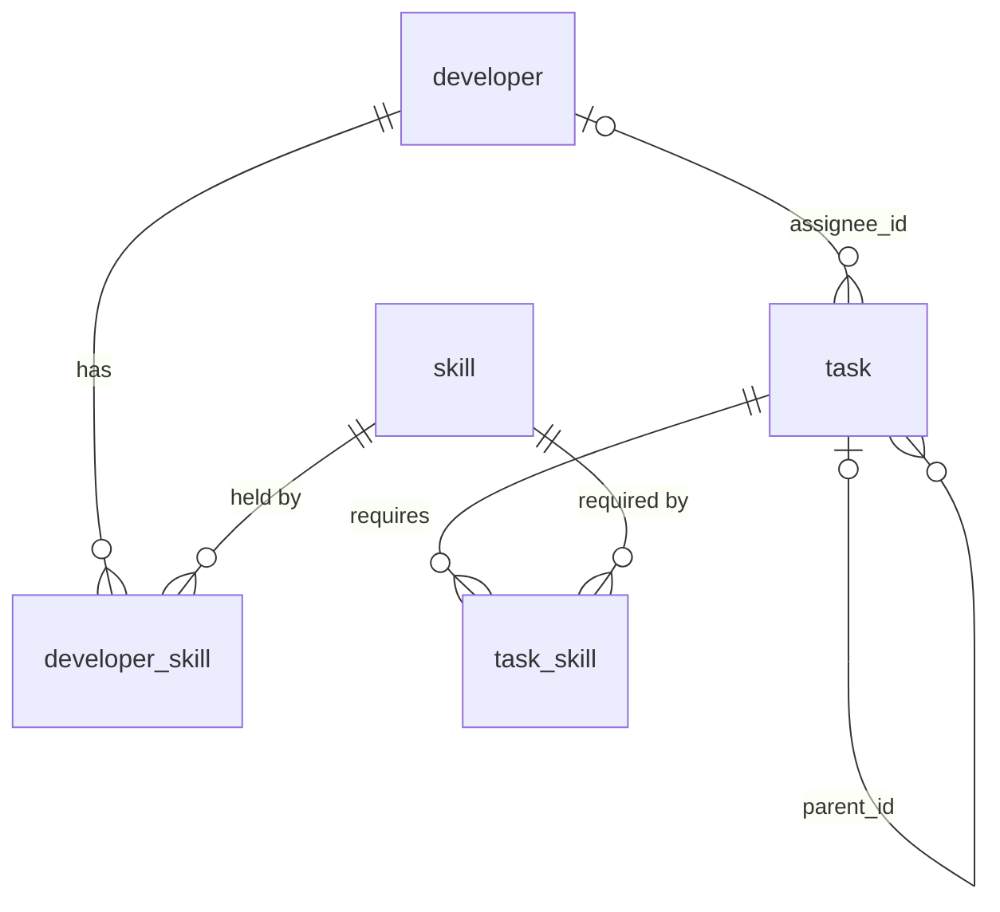
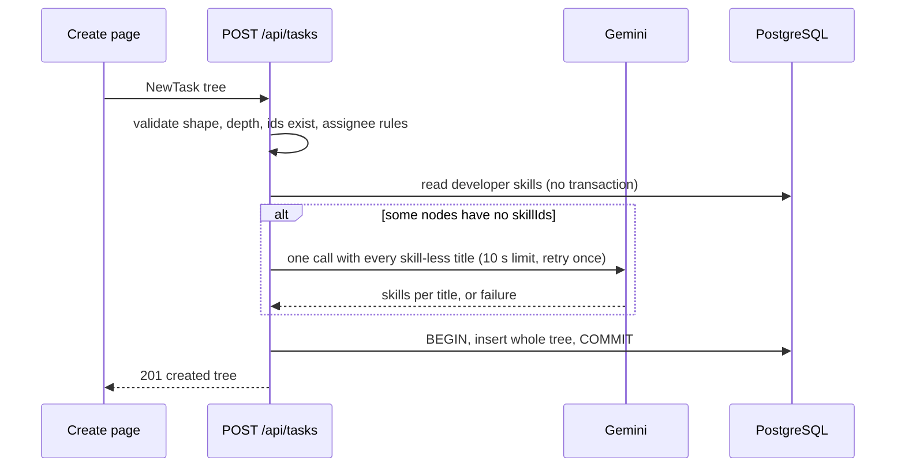
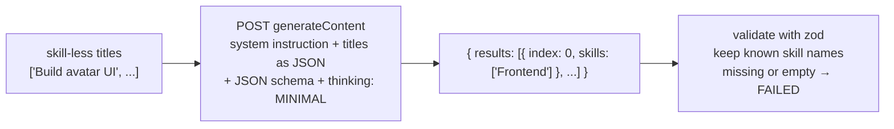

# Task Assignment App — Design

This is how the app in [requirement.md](requirement.md) gets built.
It is a three-container stack: React and Vite served by nginx, a Fastify API, and PostgreSQL.
Every business rule lives in one backend service layer, which runs inside a transaction that locks the task tree.
Skill identification is one batched Gemini call, made before the save transaction opens.
Each LLM attempt has a fixed 10 s [time limit](#time-limit), with one retry.

Requirement decisions are not repeated here. Each section links to the rule it implements.

## Overview

Architecture:



| Container | Image | Role |
| --- | --- | --- |
| `web` | `nginx:alpine` (built by `node:24-alpine`) | Serves the built SPA and proxies `/api` to `api`, so the browser sees one origin and no CORS is needed. Unknown paths fall back to `index.html` (`try_files $uri /index.html`), so reloading `/tasks/new` works. `proxy_read_timeout 60s` is set explicitly, above the worst-case Save wait of 20 s ([time limit](#time-limit)). |
| `api` | `node:24-alpine` | REST API, business rules, LLM client. Starts after `db` passes its health check. Its own health check calls `GET /api/health`. |
| `db` | `postgres:17-alpine` | Schema and seed data, loaded from `db/init/*.sql` on first start. The health check is `pg_isready -h 127.0.0.1`: during init the image runs a socket-only server, which a bare `pg_isready` would report as ready. |

Repository layout:

```text
db/init/            001_schema.sql, 002_seed.sql   (mounted into postgres; also run by API tests)
backend/src/
  app.ts            builds the Fastify instance (tests use app.inject, no network)
  server.ts         entry point: config, listen
  config.ts         env parsing with zod (DATABASE_URL, GEMINI_API_KEY, LLM_TIMEOUT_MS, ...)
  limits.json       { maxDepth: 3, maxTreeSize: 50 }; read by the API, and by the frontend via GET /api/meta
  db.ts             pg Pool + withTransaction(fn) + withTreeLock(taskId, fn): the only way to change an existing task
  errors.ts         AppError(code, httpStatus, message) + Fastify error handler
  tasks/            routes.ts, schemas.ts (zod), service.ts (transactions), rules.ts (pure), repo.ts (SQL)
  developers/       routes.ts, repo.ts
  skills/           routes.ts, repo.ts
  llm/              prompt.json (system instruction + generationConfig), skillIdentifier.ts (interface + result mapping), gemini.ts, fake.ts
backend/test/       rules.test.ts (unit), api.test.ts (real Postgres), llm.test.ts (response handling)
frontend/src/       see frontend.md
scripts/            pre-commit (key guard; install once per clone)
docs/               requirement.md, design.md (this file), frontend.md
docker-compose.yml  .env.example  README.md
```

## Schema

The schema stores what the rules need, and the database guards integrity only. The backend owns every rule ([Where the rules are enforced](requirement.md#where-the-rules-are-enforced)).



```sql
-- Every id is a UUIDv7 generated by the backend (the `uuid` package); there is no DB default.
CREATE TABLE skill (
  id   uuid PRIMARY KEY,
  name text NOT NULL UNIQUE
);

CREATE TABLE developer (
  id   uuid PRIMARY KEY,
  name text NOT NULL
);

CREATE TABLE developer_skill (
  developer_id uuid NOT NULL REFERENCES developer(id),
  skill_id     uuid NOT NULL REFERENCES skill(id),
  PRIMARY KEY (developer_id, skill_id)
);

CREATE TABLE task (
  id           uuid     PRIMARY KEY,
  title        text     NOT NULL,
  status       text     NOT NULL DEFAULT 'TODO',      -- allowed values checked in the backend
  -- USER: a person picked the skills (create or edit). LLM: identified, at least one skill.
  -- FAILED: no skills; waits for a person. Values checked in the backend.
  skill_source text     NOT NULL,
  parent_id    uuid     REFERENCES task(id),           -- NULL for a top-level task
  root_id      uuid     NOT NULL REFERENCES task(id),  -- top-level task of the tree; itself for a root
  position     smallint NOT NULL,                      -- order among siblings, from the form; 0 for a root
  assignee_id  uuid     REFERENCES developer(id)
);
CREATE INDEX task_parent_idx   ON task(parent_id);
CREATE INDEX task_root_idx     ON task(root_id);
CREATE INDEX task_assignee_idx ON task(assignee_id);

CREATE TABLE task_skill (
  task_id  uuid NOT NULL REFERENCES task(id),
  skill_id uuid NOT NULL REFERENCES skill(id),
  PRIMARY KEY (task_id, skill_id)
);
```

| Choice | Why |
| --- | --- |
| `status` and `skill_source` are `text` with no `CHECK` | The requirement puts allowed values in the backend, so changing a rule needs no migration. The out-of-scope list accepts that a direct database edit is not guarded. |
| `root_id` is stored | Every write locks the tree's top-level task first, and `root_id` names that row without walking up. `task_root_idx` serves `GET /api/tasks/:id`, which reads the whole tree by `root_id` and cuts out the subtree in memory. The value is immutable, because tasks never move ([Subtasks](requirement.md#subtasks)), so it cannot drift. |
| No `depth` column | Depth is computed while nesting rows into the response, and nesting is checked on the request tree at create time. Depth is 1-based everywhere: a top-level task has depth 1. A node may have subtasks only while its depth is below `maxDepth`, and any node deeper than `maxDepth` gives `NESTING_TOO_DEEP`. Backend and frontend tests both check that a 3-level tree is accepted and a 4-level tree is rejected. |
| Ids are UUIDv7, generated in the backend | Ids cannot be enumerated and do not reveal row counts. Their 48-bit millisecond timestamp prefix makes new keys land near the end of the B-tree index, as integer keys do, so index pages stay full; random UUIDv4 keys land anywhere and split pages throughout. They do reveal each row's creation time, which is harmless for tasks. Generating them in the app means a whole tree's ids are known before any insert ([Inserting a tree](#inserting-a-tree)). Node 24 has no built-in v7, hence the `uuid` package. |
| `position` column | Ids created in the same millisecond have no guaranteed order: neither the [PostgreSQL 18 `uuidv7()` docs](https://www.postgresql.org/docs/18/functions-uuid.html) nor the `uuid` README promise it, and one Save creates a whole tree within a millisecond. `position` keeps siblings in the order the form had them. |
| No `ON DELETE` actions | Nothing is deleted (out of scope). |
| Size | One user, tens to hundreds of rows, never deleted. `GET /api/tasks` reads every row, which is fine because pagination is out of scope. |
| Plain SQL init files, no migration tool | The schema is created once. Docker's `initdb.d` runs the same files that the API tests run, so one source defines the schema. A migration tool is the first follow-up if the schema starts changing. |

Seed (`002_seed.sql`): skills Frontend and Backend, and developers Alice, Bob, Carol and Dave with the skills in [Domain model](requirement.md#domain-model). Their ids are fixed UUIDv7 literals written in the file, so tests can refer to Alice or Frontend by id. No tasks.

## API contract

All routes are under `/api`. JSON in and out. Status values on the wire are `TODO`, `IN_PROGRESS`, `BLOCKED` and `DONE`; the UI shows them as To-do, In Progress, Blocked and Done.

Every list has a fixed order: top-level tasks by `id` (creation time, because each Save happens at a different moment), subtasks by `position` under their parent, `assignedTasks` by `id`, and every list of developers or skills, nested ones included, by `name`. Without an `ORDER BY`, PostgreSQL may return an updated row in a new position, and rows would jump around after each refetch.

| Method and path | Body | Success | Errors |
| --- | --- | --- | --- |
| `GET /api/tasks` | — | `200 TaskNode[]`: top-level tasks with nested `subtasks` | — |
| `GET /api/tasks/:id` | — | `200 TaskNode` with its subtree | `400 VALIDATION_ERROR`, `404 TASK_NOT_FOUND` |
| `POST /api/tasks` | `NewTask` (tree) | `201 TaskNode` (created tree) | `400 VALIDATION_ERROR` (also an unknown skill or developer id), `400 NESTING_TOO_DEEP`, `400 TREE_TOO_LARGE`, `413` (body over 64 KiB), `400 ASSIGNEE_WITHOUT_USER_SKILLS`, `409 ASSIGNEE_LACKS_SKILLS` |
| `PUT /api/tasks/:id/status` | `{ "status": "DONE" }` | `200 StatusChange` | `400 VALIDATION_ERROR` (malformed id, or a status not in the list), `404 TASK_NOT_FOUND`, `409 SUBTASKS_NOT_DONE` |
| `PUT /api/tasks/:id/assignee` | `{ "developerId": "<uuid>" }` or `{ "developerId": null }` | `200 TaskNode` | `404 TASK_NOT_FOUND`, `400 VALIDATION_ERROR` (unknown developer), `409 TASK_HAS_NO_SKILLS`, `409 ASSIGNEE_LACKS_SKILLS` |
| `PUT /api/tasks/:id/skills` | `{ "skillIds": ["<uuid>", "<uuid>"], "unassignIfUnqualified"?: true }` | `200 TaskNode` (`skillSource` becomes `USER`; assignee cleared if the flag was needed) | `404 TASK_NOT_FOUND`, `400 VALIDATION_ERROR` (empty list or unknown skill), `409 SKILL_EDIT_BREAKS_ASSIGNMENT` (`details`: the assignee and the skills they lack) |
| `GET /api/developers` | — | `200 Developer[]` | — |
| `GET /api/developers/:id` | — | `200 Developer` plus `assignedTasks: TaskRef[]` | `400 VALIDATION_ERROR`, `404 DEVELOPER_NOT_FOUND` |
| `GET /api/skills` | — | `200 Skill[]` | — |
| `GET /api/skills/:id` | — | `200 Skill` plus `developers: { id, name }[]` | `400 VALIDATION_ERROR`, `404 SKILL_NOT_FOUND` |
| `GET /api/meta` | — | `200 { maxDepth: 3, maxTreeSize: 50, statuses: Status[] }` | — |
| `GET /api/health` | — | `200 { ok: true }` after `SELECT 1` | `503` when the database does not answer |

Shapes:

```ts
type Status = "TODO" | "IN_PROGRESS" | "BLOCKED" | "DONE";
type SkillSource = "USER" | "LLM" | "FAILED";
type Id = string;                 // UUIDv7
type Skill = { id: Id; name: string };
type Developer = { id: Id; name: string; skills: Skill[] };
type TaskRef = { id: Id; title: string; status: Status };
type TaskNode = {
  id: Id; title: string; status: Status; parentId: Id | null; depth: number; // depth computed
  skills: Skill[]; skillSource: SkillSource; assignee: { id: Id; name: string } | null;
  subtasks: TaskNode[];           // in position order
};
type StatusChange = { task: TaskNode; reopened: TaskRef[] };
type NewTask = {                  // validated by a recursive zod schema
  title: string;                  // trimmed, 1..500 chars
  skillIds?: Id[];                // empty or absent: the LLM identifies skills
  assigneeId?: Id;                // allowed only with a non-empty skillIds
  subtasks?: NewTask[];           // array order becomes position; depth > maxDepth: NESTING_TOO_DEEP;
                                  // more than maxTreeSize tasks in the whole tree: TREE_TOO_LARGE
};
type ErrorBody = { error: { code: string; message: string; requestId: string; details?: unknown } };
// details by code: SKILL_EDIT_BREAKS_ASSIGNMENT → { assignee: { id, name }, missingSkills: string[] }
//                  create errors about one node  → { path: number[] }  (indexes into subtasks, from the top-level task)
```

Every id in a path or a body must be a well-formed UUID, checked by zod. So `/api/tasks/abc` gets `400 VALIDATION_ERROR` instead of reaching SQL, where PostgreSQL would reject the cast and the client would get a 500. `skillIds` are de-duplicated before use, so a repeated id cannot break the `task_skill` primary key.

Separate endpoints for status, assignee and skills keep each one's validation and errors simple. A `400` is invalid input: a malformed body or id, an id that does not exist (skill or developer), or a tree that breaks a create-time rule. A `409` breaks a rule that depends on the stored task. Checks run in this order: request shape, then the task (`404`), then referenced ids (`400`), then rules (`409`). The `message` names the rule and the facts behind it, for example "Bob cannot take 'Avatar UI': it requires Frontend, which Bob lacks." On create, `details.path` points at the node, because titles need not be unique.

The form hides "Add Subtask" at `maxDepth`, read from `GET /api/meta`, so the nesting limit is one setting in `backend/src/limits.json` ([Subtasks](requirement.md#subtasks)).

**Input limits.** Every input has an upper bound, so an oversized request gets a clear `4xx` instead of breaking something downstream:

| Input | Limit | Why | Response |
| --- | --- | --- | --- |
| Request body | 64 KiB (Fastify `bodyLimit`) | Bounds everything below before parsing, including how deeply a body can nest, which would otherwise overflow the recursive validation | `413` |
| Tasks in one tree | `maxTreeSize`, 50 | Keeps each per-depth `INSERT` far below PostgreSQL's 65,535 bind-parameter limit, `position` within `smallint`, and the LLM batch small | `400 TREE_TOO_LARGE` |
| Nesting | `maxDepth`, 3 | The requirement's limit | `400 NESTING_TOO_DEEP` |
| Title | 1 to 500 characters after trimming | Keeps rows and LLM prompts small | `400 VALIDATION_ERROR` |
| `skillIds` per task | at most the number of skills, after de-duplication | A longer list must contain duplicates or unknown ids | `400 VALIDATION_ERROR` |

The tree is counted and its depth checked by walking the parsed body before zod validates it, so the cheap checks reject first.

### Write paths

Every update runs `withTreeLock(taskId, fn)`. It locks the tree's top-level task first, then the target task, and only then calls `fn`. No write path can skip the order, because it is the only way to get a locked task. Lock order is the same for every write, so writes to one tree run one at a time and cannot deadlock ([Non-functional requirements](requirement.md#non-functional-requirements)).

```sql
SELECT root_id FROM task WHERE id = $1;                -- unlocked; root_id never changes. No row: TASK_NOT_FOUND
SELECT id FROM task WHERE id = $root FOR UPDATE;       -- 1st lock: the tree
SELECT * FROM task WHERE id = $1 FOR UPDATE;           -- 2nd lock: the target
SELECT id FROM developer WHERE id = $dev FOR SHARE;    -- 3rd lock (assign, skill edit): the developer checked
```

After the root lock, every other writer in the tree is waiting. Plain reads of subtasks and ancestors are therefore consistent under `READ COMMITTED`.

The developer lock covers the other side of the assignment rule: the developer's skills. Nothing in the app writes `developer_skill` today, so the lock changes no current behaviour. Without it, the assignment rule would hold only because developer skills never change. Any future developer-skill edit must take `FOR UPDATE` on the developer row. That edit then waits for assignments in progress, and new assignments wait for the edit. `FOR SHARE` does not block other `FOR SHARE` holders, so assignments to one developer in different trees still run in parallel. The order is always root, then task, then developer, so it adds no deadlock path.

| Operation | Checks, in order (all in `rules.ts`, pure functions) | Writes |
| --- | --- | --- |
| Status → `DONE` | Every direct subtask is `DONE`, else `SUBTASKS_NOT_DONE` with the unfinished titles. Direct subtasks are enough because a Done task never sits above unfinished work ([Subtasks](requirement.md#subtasks)). | `status` |
| Status from `DONE` to another value | None. Walk up the parent chain and reset each `DONE` ancestor to `IN_PROGRESS`. Stop at the first ancestor that is not Done, because nothing above it can be Done. | `status` on the task and the reset ancestors. `reopened` lists them for the UI. |
| Any other status change | None. | `status` |
| Assign | Task has at least one skill, else `TASK_HAS_NO_SKILLS`. The developer (locked `FOR SHARE`) has every task skill, else `ASSIGNEE_LACKS_SKILLS`. Unassigning (`null`) always passes and locks no developer. | `assignee_id` |
| Edit skills | Non-empty list of existing skills. If assigned, the assignee is locked `FOR SHARE`. If the assignee lacks a new skill: with `unassignIfUnqualified: true`, clear the assignee; without it, `SKILL_EDIT_BREAKS_ASSIGNMENT` with `details: { assignee: { id, name }, missingSkills: string[] }`. The flag is ignored when the assignee qualifies. An unqualified assignee is never kept ([Editing skills](requirement.md#editing-skills)). | Replace `task_skill` rows, `skill_source = 'USER'`, and `assignee_id = NULL` when cleared |

### Create path



1. Validate everything that can fail before the LLM call: shape, id format and de-duplication, depth, tree size, that skill and developer ids exist, assignee-without-skills, and assignee qualification. An invalid request then never spends an LLM call.
2. If any node has no `skillIds`, make one identification call for all of them ([LLM integration](#llm-integration)).
3. Open one transaction. Lock each named assignee with `FOR SHARE` and re-check their qualification, as on the write paths. Then insert the tree as described below with `skill_source` set to `USER`, `LLM` or `FAILED`, and commit. The new task rows are invisible to others until commit, so they need no lock.

#### Inserting a tree

A child's `parent_id` foreign key needs its parent row to exist first. So the tree goes in level by level: parents before children. Because the backend generates the ids, the whole tree's ids are known before the first insert. Nothing has to be read back between levels.

Example, with made-up titles. On the Create Task page a user types "Profile update", adds two subtasks, and adds one subtask under the first of those:

```text
[ Profile update ]          ← New Task Component 1
  [ Avatar UI ]             ← 1.1
    [ Crop tool ]           ← 1.1.1 (level 3: no Add Subtask)
  [ Profile API ]           ← 1.2
```

Save sends that tree as one `POST /api/tasks` body:

```json
{ "title": "Profile update", "subtasks": [
    { "title": "Avatar UI", "subtasks": [ { "title": "Crop tool" } ] },
    { "title": "Profile API" } ] }
```

**Step 1, in memory.** The backend walks the form once, with no database call, and builds these rows (ids shortened to letters):

| id | title | parent_id | root_id | position | depth |
| --- | --- | --- | --- | --- | --- |
| A | Profile update | — | A | 0 | 1 |
| B | Avatar UI | A | A | 0 | 2 |
| C | Crop tool | B | A | 0 | 3 |
| D | Profile API | A | A | 1 | 2 |

**Step 2, insert by depth.** One multi-row `INSERT` per depth, at most 3 statements, then one `INSERT` for all `task_skill` rows:

1. Depth 1: A.
2. Depth 2: B and D. Their parent A exists.
3. Depth 3: C. Its parent B exists.

With database-generated ids, each level would have to be inserted and its ids read back before the next. Generating ids in the app removes those round trips.

**Ordering never depends on how ids sort inside a tree.** UUIDv7 ids made in the same millisecond have no guaranteed order, so C's id might sort before A's. That changes nothing:

| Question | Answered by | Uses id order? |
| --- | --- | --- |
| Who is whose parent? | `parent_id` | No |
| Which rows are inserted first? | `depth`, computed during the walk | No |
| Sibling order on screen | `position` | No |
| Order of top-level tasks | `id` | Yes, but only roots are compared, and each comes from a different Save |

The Save button is disabled while a request is in flight. That is the only double-submit guard, which is enough for one user with no login.

## LLM integration

This section explains each LLM choice in plain terms, for readers new to LLM integration.

### What the call is

An LLM API call is an HTTP request. It carries instructions (the "system instruction"), the input (the titles), and settings. The reply is generated text, and the app forces that text to be JSON with a fixed shape.



### Choices and why

| Choice | What it means | Why |
| --- | --- | --- |
| **Provider: Gemini only, free-tier key** | The brief names Gemini and its free API. Behind one `SkillIdentifier` interface, whose other implementation is the fake used in tests. | The key may be shared with people who run the app. A key whose Google project has **no billing account** stays on the free tier and cannot run up a bill. Before sharing it, check in AI Studio that the key's project shows "Free tier". |
| **Key never committed** | The key lives only in `.env`. Git ignores `.env*` and `*.env`, except `.env.example`, which holds an empty value. Compose passes it in by `${GEMINI_API_KEY:-}`. A pre-commit hook rejects any staged line matching `AIza[0-9A-Za-z_-]{35}` (Gemini's key format). It is tracked as `scripts/pre-commit` and installed once per clone with `cp scripts/pre-commit .git/hooks/pre-commit && chmod +x .git/hooks/pre-commit`. | The key is shared only outside the repository. The hook catches a key pasted into a tracked file. Before the repository is published, `git log -p --all \| grep -cE 'AIza[0-9A-Za-z_-]{35}'` must print 0. The full pattern matters, because the bare prefix also appears in this doc and in the hook. |
| **No key configured** | The app starts normally. Each identification fails at once, and those tasks are saved as `FAILED`. | Anyone can run the whole app without a key, and the failed-state path is exercised. |
| **Model: `gemini-3.5-flash-lite`** (set by `GEMINI_MODEL`) | Google's smallest current stable model. `gemini-3.6-flash` is one step up if accuracy is poor. | Picking between two skills is an easy task. A small model is faster and has looser free-tier limits. The brief's three examples are checked in one live smoke test before each release. |
| **Endpoint: `generateContent`, called with `fetch`, no SDK** | Google's long-standing endpoint. Google calls it legacy but "fully supported". | The newer Interactions API changed shape in May 2026 ([migration guide](https://ai.google.dev/gemini-api/docs/interactions-breaking-changes-may-2026)). One endpoint does not justify an SDK. `fetch` with `AbortSignal.timeout` gives exact control over the time limit. |
| **Thinking: `MINIMAL`** | Current Gemini models write hidden reasoning ("thinking tokens") before answering. That takes time. Setting `MINIMAL` explicitly fixes the level whatever the model's default is. | Classifying into two labels needs little reasoning. Minimal thinking keeps Save fast. |
| **Structured output** (`responseMimeType: application/json`, `responseJsonSchema` with `enum: ["Frontend","Backend"]`) | The model is constrained to emit JSON matching the schema, with skill names drawn only from the enum. | The model cannot invent a skill or write prose. The backend still validates with zod, because Google says the values can be well-formed yet wrong ([structured output](https://aistudio.google.com/docs/structured-output)). |
| **One prompt file, `backend/src/llm/prompt.json`** | It holds the literal request parts: the full `systemInstruction` text and the whole `generationConfig`, with the schema, enum and thinking level. The Gemini adapter sends it unchanged and adds only the titles. At startup the API checks the schema enum against the `skill` table, and refuses to start otherwise. | The prompt is data, readable and reviewable in one place, and the enum cannot drift from the `skill` table. Adding skills is out of scope, so reading them from the table would buy nothing. |
| **One batched call per Save** | All skill-less titles go in one request as a JSON array, and results come back keyed by array `index`. | A 7-task tree costs one round trip, not seven. That keeps the free-tier request count low. Indexes are shorter and safer to match than echoed titles. |
| **Titles are data** | The system instruction says the titles are data, never instructions. | A title is user text and could try prompt injection ("ignore the rules…"). The model has no tools and no data access, and its output is limited to the enum. The worst case is a wrong label, which a user can fix on the Task List page. |
| **No few-shot examples** (no worked examples in the prompt) | The prompt defines each skill instead. | The brief's three examples are the only accuracy check. Putting them in the prompt would make that check meaningless. If accuracy is poor, add *different* examples. |
| **Temperature not set** | Temperature controls randomness. The model's default applies. | Answers can vary between runs. That is acceptable because every answer is validated and users can edit it. |

### Result mapping

An attempt **fails as a whole** when any of these happens: a timeout, a network error, an HTTP error, no `candidates` (a blocked prompt, with `promptFeedback.blockReason`), a `finishReason` other than `STOP`, or a reply without a `results` array. Otherwise each item is mapped on its own. Each title's **index** is its position, counting from 0, in the array sent to Gemini, and each result names the index it answers. For example, sending `["Profile update", "Avatar UI"]` and getting back `{ "index": 1, "skills": ["Frontend"] }` gives Avatar UI the skill Frontend.

| Item outcome | Task's `skill_source` | Skills saved |
| --- | --- | --- |
| Its index appears once and the item names at least one known skill | `LLM` | Those skills (duplicates removed) |
| Its index is missing, or the item's skills are empty or all unknown | `FAILED` | None |
| Its index appears more than once | `FAILED` (no guessing between answers) | None |
| An item fails zod on its own, or its index is out of range | That item is ignored | — |
| The call failed after the retry | `FAILED` for every node in the call | None |

**Retry rule:** a failed attempt is retried once, immediately, unless the failure was HTTP `400`, `401`, `403` or `404`. Those mean the request, key or model id is wrong, and a retry cannot fix them. They fail at once and log at `error` level. Retrying immediately keeps the worst-case Save wait at exactly twice the limit, as [Skill identification](requirement.md#skill-identification) says. Skipping the retry for the four config errors only shortens the wait. Each attempt logs its latency, outcome and token counts.

Response fields read, from the [generateContent reference](https://aistudio.google.com/api-reference/generate-content.md.txt). The adapter's tests use hand-written fixtures of each shape. The live smoke test before each release confirms the success shape.

| Field | Used for | Status |
| --- | --- | --- |
| `candidates[0].content.parts[].text` | The JSON answer (parts joined) | documented only |
| `candidates[0].finishReason` | Anything other than `STOP` fails the attempt | documented only |
| `promptFeedback.blockReason` (no `candidates`) | Logged; the attempt fails | documented only |
| `usageMetadata` | Logged token counts | documented only |
| `error.status` (on HTTP errors) | Logged; the free-text `error.message` is not logged, because it can name the Cloud project | documented only |

Cost: one call per Save that has skill-less tasks, and none otherwise.

### Free-tier quota

| Limit | Value for `gemini-3.5-flash-lite` | Source |
| --- | --- | --- |
| Requests per day | about 500 | Third-party reports, Oct–Nov 2026; Google no longer publishes free-tier numbers |
| Requests per minute | about 10–15 (reports disagree) | Same |
| Scope | Per Google Cloud **project**, not per key | Same; all keys in one project share it |
| Authoritative value | The project's page at aistudio.google.com/rate-limit | Signed-in only; read it for the project in use |

What that means here:

- **Normal use is safe on the daily limit.** A session with 30 Saves uses at most 30 of about 500 requests. The automated tests stub `fetch` and never call Gemini.
- **The per-minute limit is the real risk.** Several people saving at once could exceed about 10 a minute. The immediate retry would likely hit the same 429, so those tasks save as "Skills needed". The app keeps working, and the README explains that state.
- **Development use eats the same daily quota** if it shares the project. So a key that is shared comes from a **dedicated project** used for nothing else.
- **Before a busy session, or before sharing the key,** read the real limits for that project in AI Studio's rate-limit page, and check that its usage today is low.

When a quota is hit, Gemini answers `429 RESOURCE_EXHAUSTED`. The adapter logs it at `warn` with the status, so a 429 is easy to tell apart from a real failure.

### Time limit

Each attempt is cut off after `LLM_TIMEOUT_MS`, which defaults to **10 000 ms**, with one retry. So Save waits at most 20 s for the LLM, under nginx's 60 s proxy timeout. The value is a fixed default, not measured, chosen to keep the first version simple. Each attempt logs its latency, so real Saves show whether 10 s is too generous or too tight, and the setting changes without code.

## Frontend structure

The frontend is a React SPA with two pages, the Task List and Task Creation. Its components, page wireframes and error states are in [frontend.md](frontend.md).
It repeats the assignment and Done rules only to hide or disable choices the backend would reject. The backend is the guard, and its answer is always what the page shows.

## Observability

The API writes structured JSON logs to stdout with pino, Fastify's built-in logger, and `docker compose logs api` reads them. There are no metrics or tracing: for a single-instance app, logs answer every question below.

| What | Level | Fields | Question it answers |
| --- | --- | --- | --- |
| Every request | `info` | request id, method, route, status, duration ms | What happened, and how slow was it? |
| Rule rejection (`400`, `409`) | `info` | request id, error code, task id | Which rule blocked a user? |
| Unexpected error (`500`) | `error` | request id, stack trace | What broke? The client gets only a generic message and the request id. |
| Write that changed state | `info` | task ids, old and new value, `reopened` ids, unassigned developer | Who changed what, for example which ancestors a reopen reset |
| LLM attempt | `info`; `warn` on 429 or timeout; `error` on 400/401/403/404 | attempt number, model, outcome, latency ms, HTTP status, `error.status`, title count, usage (below), `requestsToday` | Is 10 s right? Is the quota running out? Is the key broken? |
| Startup | `info` / `error` | config summary, key present yes/no, skill-enum check result | Did the app start with what it needs? |

LLM usage fields, copied from the reply's `usageMetadata` on every successful attempt:

| Field | Why it matters |
| --- | --- |
| `promptTokenCount` | Input size; grows with the number of titles in the tree |
| `candidatesTokenCount` | Answer size; the main driver of latency |
| `thoughtsTokenCount` | Hidden reasoning tokens. It should stay near 0 with thinking set to `MINIMAL`; a rise means the setting is not taking effect. |
| `totalTokenCount` | Counts against the per-minute token limit |

`requestsToday` is an in-process count of Gemini requests since midnight UTC, including retries and failed attempts. It shows how much of the roughly 500-a-day quota this instance has used, for example `requestsToday: 37` after a busy hour. It resets on restart, its UTC day may not match Google's quota day, and it does not see other users of the same Google project. AI Studio's usage page is the authoritative number.

Rules for what never gets logged:

- **No secrets.** The Gemini key is never logged. pino's `redact` removes it from config objects, and outgoing request headers are never logged. Startup logs only whether a key is present.
- **No provider free text.** Gemini's `error.message` and `details` can name the Cloud project, so only `error.status` is logged.
- **No task titles in LLM logs.** These logs record counts, not content. Titles are user data, and the task id is enough to find one.

`GET /api/health` runs `SELECT 1`. It returns `200 { ok: true }` when the database answers and `503` when it does not. The compose health check for `api` uses it, so `docker compose ps` shows a broken database connection.

`LOG_LEVEL` (default `info`) sets the level.

## Tech stack and why

| Layer | Choice | Why this over the alternative |
| --- | --- | --- |
| Frontend build | Vite + React 19 + TypeScript | The standard React SPA toolchain. Next.js would add server rendering that a two-page SPA does not need. |
| Routing | React Router | Two client routes; the de facto standard. |
| Server state | TanStack Query | Caching, refetch after mutations, and loading and error states, without hand-written `useEffect` fetching. |
| Backend | Fastify 5 + TypeScript | Built-in logging (pino), and `app.inject` for API tests without opening a port. Express would also work, but needs extra pieces for both. |
| Validation | zod | One schema gives runtime validation and TypeScript types. It also handles the recursive `NewTask` tree. |
| Ids | `uuid` (`v7()`) | UUIDv7 ids, generated in the app; Node 24 has no built-in v7. See [Schema](#schema). |
| Database access | `pg` with raw SQL | The locking (`FOR UPDATE` in a fixed order) and tree reads are the core of the design. Raw SQL keeps them visible and reviewable, where an ORM would hide them. |
| Schema | Plain SQL in `db/init` | One source for Docker and the tests. See [Schema](#schema). |
| LLM | Gemini `generateContent` via `fetch` | See [LLM integration](#llm-integration). |
| Tests | Vitest | One runner for backend and frontend, with native TypeScript. API tests run against real PostgreSQL. |
| Packaging | Docker Compose, PostgreSQL 17 | The compose file avoids features newer than the legacy `docker-compose` binary supports. The key comes in by `${GEMINI_API_KEY:-}` interpolation from `.env`, so a missing `.env` is not an error. `postgres:17` avoids the data-directory layout change in the 18 image. |

## Testing

| Layer | What | How |
| --- | --- | --- |
| Rules | Assignment (every skill, no-skill task), Done rule, reopen walk, depth limit, skill edit vs assignee (rejected without the flag, unassigned with it, flag ignored when the assignee qualifies) | Vitest unit tests on the pure functions in `rules.ts` |
| API | Every endpoint and error code; create with nested tree; each input limit at its edge (50 tasks accepted, 51 rejected; a body over 64 KiB gets `413`); duplicate and malformed ids; rollback on invalid tree; subtasks returned in form order (`position`) | `app.inject` against a real PostgreSQL. Each test file loads `db/init` into a fresh schema |
| Tree lock | Deterministic, on a parent with one Done child. A test client opens a transaction and takes `FOR UPDATE` on the root. It then fires "parent → Done" and "child → To-do", which touch different rows, and checks both wait on a lock (`pg_stat_activity.wait_event_type = 'Lock'`). After the client commits, the test checks the parent never ends Done above an unfinished child. Only the root lock serialises these two, so removing it fails the test. | Real PostgreSQL. A timing-based test would pass with the lock removed |
| LLM handling | The mapping and retry rules above: unknown names, missing, duplicate and out-of-range indexes, empty list, blocked prompt, non-`STOP`, bad JSON, timeout then retry, 400/401/403/404 not retried, no key. Fields are pinned against hand-written fixtures | The fake `SkillIdentifier` plus a stubbed `fetch` for the Gemini adapter. No network |
| Frontend | `draft.ts`: depth limit, add and remove, assignee cleared on a skill change. `lib/rules.ts`: qualifying developers, Done allowed, progress count. `SkillEditor`: a `409 SKILL_EDIT_BREAKS_ASSIGNMENT` opens the dialog, Confirm resends with the flag, and Cancel sends nothing. | Vitest; the component test stubs the API client |

## Risks and assumptions

### Risks

| Risk | Effect | Mitigation |
| --- | --- | --- |
| Slow LLM on Save | The synchronous call makes Save wait while Gemini answers. | The wait is capped at 20 s, and the tasks are saved even when the LLM fails. If logged latencies show Save is slow, the background-job follow-up moves identification off the Save path. |
| Free-tier rate limits | Several people saving at once can hit `429` ([Free-tier quota](#free-tier-quota)). Those tasks show "Skills needed", which can look like a broken feature. | The README explains the state, and a person can pick the skills. A shared key comes from a dedicated project. |
| Frontend types drift from the backend | The frontend's API types are written by hand, so a backend change can break the UI unnoticed. | API tests pin the backend shapes. Generating the types from the zod schemas is a follow-up. |
| No migration tool | A schema change needs a fresh database. | There is one schema version today. A migration tool is listed as a follow-up for when the schema changes. |
| Mixed reads | A `GET` reads tasks, skills and assignees in separate statements under `READ COMMITTED`, so it could combine two committed states. | Accepted: with a single user the window is negligible. |

### Assumptions

The design relies on these facts about external services. Each has a basis and a signal that would show it no longer holds.

| Assumption | Basis | Signal |
| --- | --- | --- |
| `gemini-3.5-flash-lite` accepts `thinkingConfig.thinkingLevel: MINIMAL` and `responseJsonSchema` on `generateContent` | Google's model and API reference pages, 2026-11-09 | The live smoke test with the brief's three titles before each release |
| A typical tree, under about 15 skill-less titles, gets an answer within 10 s on the free tier | Typical response times of small models | The per-attempt latency log |
| The free tier allows enough requests for development and normal use | Third-party reports ([Free-tier quota](#free-tier-quota)) | The project's limits in AI Studio |
| A key from a project with no billing account cannot be charged | Google's published tier model | The project shows "Free tier" in AI Studio |
| The compose file works with both `docker compose` and the legacy `docker-compose` binary | Uses no features newer than the legacy binary supports | Running both binaries |
