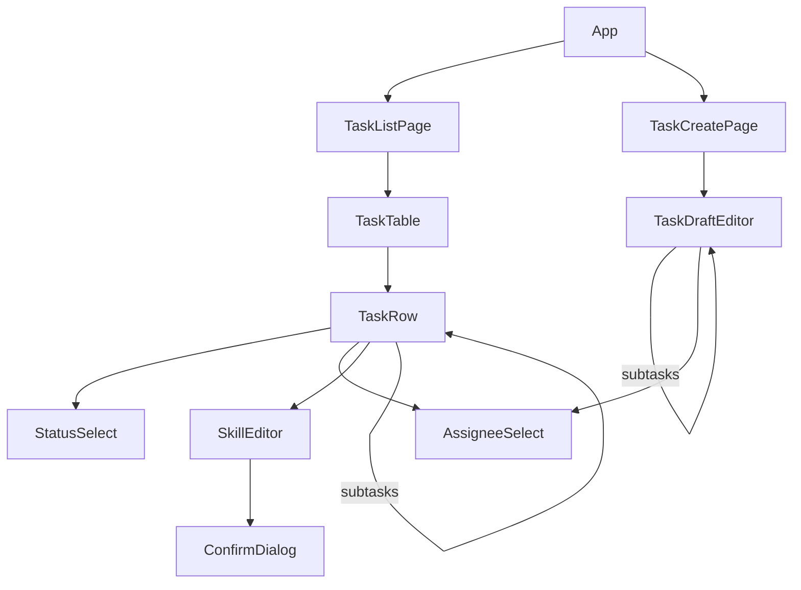

# Task Assignment App — Frontend

This is the frontend part of [design.md](design.md): the two pages, their components, and how each page handles API answers.
The frontend is a React SPA with two routes: the Task List at `/` and Task Creation at `/tasks/new`.
Server data comes through TanStack Query, and every successful change refetches the task list.
The backend is the only source of truth. The frontend repeats the assignment and Done rules only to hide or disable choices the backend would reject.
Request and response shapes are in [design.md → API contract](design.md#api-contract).

## Components

The code is grouped by feature, one folder per page, with shared code beside it. See [design.md → Code organisation](design.md#code-organisation) for why.

```text
frontend/src/
  main.tsx                      QueryClientProvider + RouterProvider
  app/App.tsx                   layout + nav; routes "/" → TaskListPage, "/tasks/new" → TaskCreatePage
  api/client.ts                 fetch wrapper; throws RequestError(status, code, message, details, requestId)
  api/types.ts                  mirrors the API shapes in design.md
  api/queries.ts                TanStack Query hooks: useTasks, useDevelopers, useSkills, useMeta, mutations
  components/Notice.tsx         reopened banner and error banner
  components/AssigneeSelect.tsx only qualifying developers + "Unassigned"; disabled with no skills (both pages)
  lib/rules.ts                  pure: qualifying developers, Done allowed, progress count (unit-tested)
  features/task-list/
    TaskListPage.tsx
    TaskTable.tsx               table head + rows
    TaskRow.tsx                 recursive: renders a row, then its subtasks when expanded
    StatusSelect.tsx            Done disabled with a reason while subtasks are unfinished
    SkillEditor.tsx             pick skills; FAILED shows as "Skills needed" with a prompt; confirm dialog opened by the backend's 409
    ConfirmDialog.tsx           the skill-edit confirm
  features/task-create/
    TaskCreatePage.tsx
    TaskDraftEditor.tsx         recursive form node; "Add Subtask" hidden at maxDepth, disabled at maxTreeSize
    draft.ts                    pure tree reducer: add subtask, remove, update field, clear assignee (unit-tested)
```

Imports go one way: `app` imports features, and features import only the shared folders (`api`, `components`, `lib`). Features never import each other, and shared code never imports a feature. An ESLint `import/no-restricted-paths` rule, added with the frontend's lint script, will enforce this, so a wrong import fails the lint instead of relying on review.



## Task List page

```text
Tasks                                                                   [ + New task ]
┌──────────────────────────────────────────────────────────────────────────────────────┐
│ ⓘ Profile update moved back to In Progress.                                    [×]   │  ← reopened notice
└──────────────────────────────────────────────────────────────────────────────────────┘
  Task                          Skills                         Status          Assignee
▾ Profile update   1/2 done     Frontend, Backend  ✎  (LLM)    [In Progress▾]  [Carol ▾]
    Can't be Done: 1 subtask not Done (Profile API)
  ▸ Avatar UI      1/1 done     Frontend  ✎  (user)            [Done ▾]        [Alice ▾]
    Profile API                 Skills needed  [Pick skills]   [To-do ▾]       [— ▾] (disabled)
  Write onboarding docs         Skills needed  [Pick skills]   [To-do ▾]       [— ▾] (disabled)
```

| Element | Behaviour | Data |
| --- | --- | --- |
| ▾ / ▸ toggle | Shown on rows with subtasks. Every row starts expanded. Expansion is kept in page state by task id, so a refetch does not collapse rows. | `subtasks` |
| "1/2 done" | Counts **direct** subtasks only, matching [the Done rule](requirement.md#subtasks) | `subtasks[].status` |
| Skills cell | Skill names sorted by name, then the source: "(user)" or "(LLM)". A task with source `FAILED` shows "Skills needed" and a "Pick skills" button. ✎ opens the skill editor. | `skills`, `skillSource` |
| Status dropdown | Lists every status from `GET /api/meta`. Done is disabled while any direct subtask is not Done, and a line under the row names those subtasks. | `statuses`, `subtasks` |
| Assignee dropdown | Lists "Unassigned" plus the developers who have every task skill. It is disabled with "Pick skills first" when the task has no skills. | `useDevelopers()`, `skills` |
| Reopened notice | After a status change returns a non-empty `reopened`, one dismissible banner at the top lists them, for example "Profile update moved back to In Progress." It stays until dismissed or the next change. | `StatusChange.reopened` |

The qualifying-developer filter and the Done-disable check are frontend conveniences. The backend is the guard.

**Skill editor.** ✎ or "Pick skills" opens a popover with one checkbox per skill (from `GET /api/skills`), plus Save and Cancel. Save is disabled while no box is ticked. Cancel closes it and discards the change. Save works as follows:

- **Skill edits that break the assignment:** the backend decides, and the frontend shows its answer. Save sends the edit without the flag. If the assignee still qualifies, it returns `200` and that is the only call. If not, it returns `409 SKILL_EDIT_BREAKS_ASSIGNMENT` with the assignee and the skills they lack. The frontend turns that into "Alice lacks Backend. Save and unassign Alice?". Confirm resends with `unassignIfUnqualified: true`, and Cancel saves nothing. The frontend never repeats the rule itself, so the backend stays the only source of truth.

```text
PUT /skills { skillIds }                 ← the real save
 ├─ assignee qualifies ─▶ 200 (one call)
 └─ assignee lacks one ─▶ 409, details { assignee: Alice, missingSkills: [Backend] }
        dialog ─▶ Confirm ─▶ PUT /skills { skillIds, unassignIfUnqualified: true } ─▶ 200
               └▶ Cancel  ─▶ nothing saved; the editor stays open with the draft
```

```text
┌ Change skills? ─────────────────────────────────┐
│ Alice lacks Backend.                            │
│ Saving will unassign Alice from this task.      │
│                    [ Cancel ]  [ Save and unassign ] │
└─────────────────────────────────────────────────┘
```

## Task Creation page

```text
Create Task(s)
┌───────────────────────────────────────────────────────────────────────────┐
│ Title [ Profile update                          ]                         │
│ Skills ☑ Frontend ☑ Backend    Assignee [ Carol ▾ ]    [ Add Subtask ]    │
│   ┌───────────────────────────────────────────────────────────────────┐   │
│   │ Title [ Avatar UI                    ]                     [ × ]  │   │
│   │ Skills ☐ Frontend ☐ Backend   Assignee [ — ▾ ] (pick skills first)│   │
│   │ No skills picked: they will be identified when you save.          │   │
│   │                                           [ Add Subtask ]         │   │
│   └───────────────────────────────────────────────────────────────────┘   │
└───────────────────────────────────────────────────────────────────────────┘
                                                [ Cancel ]  [ Save ]
```

- **Form state** is one `useReducer` tree of `{ key, title, skillIds, assigneeId, subtasks }`, the same field names as the API. Recursive `TaskDraftEditor` components render it. Depth comes from the path.
- **Add Subtask** is hidden at `maxDepth` (3 levels), and disabled with "Limit of 50 tasks reached" once the tree has `maxTreeSize` (50) tasks. Both limits come from `GET /api/meta`. **×** removes a subtask and everything under it; the top-level task has no ×.
- **Assignee** uses the same `AssigneeSelect` as the Task List, so it lists only qualifying developers. Changing a node's skills clears its assignee if they no longer qualify, and clearing all skills clears it too. This avoids a Save that the backend would reject.
- **Save** is disabled until `GET /api/meta` and the developer list have loaded, and while any title is empty. While the request runs, the button reads "Saving — identifying skills…", because the LLM wait can take up to twice `LLM_TIMEOUT_MS`, 40 s at the default ([time limit](design.md#time-limit)).
- **On success** (`201`), the page goes to the Task List and briefly highlights the new tree, so the identified skills, or "Skills needed", are visible at once.
- **On error**, the draft is kept. A banner above Save shows the message. When `details.path` is present (the indexes into `subtasks` from the top-level task, for example `[0, 1]`), the matching node gets a red outline. For a `500`, a network error or an nginx `504`, the banner says the save failed and shows the request id.

## Page states and errors

| State | Task List | Task Creation |
| --- | --- | --- |
| Loading | "Loading tasks…" in place of the table | Form shown; Save disabled until meta and developers load |
| Empty | "No tasks yet." with a link to Create Task | — |
| Fetch failed | "Couldn't load tasks." with a Retry button | Banner with Retry; Save disabled |
| Change in flight | That row's control is disabled; others stay usable | Save disabled, "Saving — identifying skills…" |
| `409 SKILL_EDIT_BREAKS_ASSIGNMENT` | Opens the confirm dialog | — |
| Any other `400` or `409` | The control reverts, and the message shows under the row until the next change on that row | Banner plus node outline; draft kept |
| `404 TASK_NOT_FOUND` | Message under the row; the list refetches | — |
| `500`, network error, `504` | Banner "Something went wrong (request id …)"; the control reverts | Same banner; draft kept |

Error handling switches on `code`: `SKILL_EDIT_BREAKS_ASSIGNMENT` goes to the dialog, and every other error goes to the row or the banner. Every successful change invalidates the `tasks` query, so the list refetches from the server, which stays the only truth.

**Styling** is plain CSS, with no component library. Two pages do not justify one. Status values show as To-do, In Progress, Blocked and Done.
