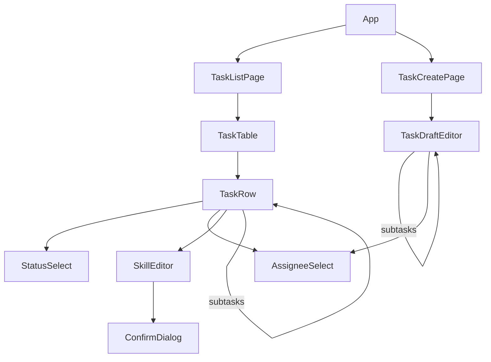

# Task Assignment App — Frontend

This is the frontend part of [design.md](design.md): the two pages, their components, and how each page handles API answers.
The frontend is a React SPA with two routes: the Task List at `/` and Task Creation at `/tasks/new`.
Server data comes through TanStack Query, and every successful change refetches the task list.
The backend is the only source of truth. The frontend repeats a few backend checks (the assignment rule, non-empty titles, at least one skill on a skill edit, and the depth and size limits) only to hide, disable or clear choices the backend would reject.
Request and response shapes are in [design.md → API contract](design.md#api-contract).

## Components

The code is grouped by feature, one folder per page, with shared code beside it. See [design.md → Code organisation](design.md#code-organisation) for why.

```text
frontend/src/
  main.tsx                      QueryClientProvider + RouterProvider
  app/App.tsx                   layout + nav; routes "/" → TaskListPage, "/tasks/new" → TaskCreatePage
  api/client.ts                 fetch wrapper; throws RequestError(status, code, message, details, requestId)
  api/types.ts                  mirrors the API shapes in design.md
  api/queries.ts                TanStack Query hooks: useTasks, useDevelopers, useSkills, useMeta, mutations
  components/Notice.tsx         reopened banner and error banner
  components/Modal.tsx          native <dialog> shown with showModal(); Esc goes to the component that opened it,
                                the backdrop does nothing, and focus returns to the button that opened it
  components/AssigneeSelect.tsx only qualifying developers + "Unassigned"; disabled with no skills (both pages)
  lib/rules.ts                  pure: qualifying developers, progress count (unit-tested)
  lib/navigation.ts             router state that carries a new task's id to the list, for the highlight
  test/                         fixtures, setup and polyfills for vitest
  features/task-list/
    TaskListPage.tsx
    TaskTable.tsx               table head + rows
    TaskRow.tsx                 recursive: renders a row, then its subtasks when expanded; FAILED shows as
                                "Skills needed"; one skills button ("Pick skills" or ✎); a refused change reverts
    taskListContext.ts          what the page hands every row, including row errors kept by task id
    StatusSelect.tsx            every status, all selectable
    SkillEditor.tsx             modal to pick skills; confirm dialog opened by the backend's 409
    ConfirmDialog.tsx           the skill-edit confirm
  features/task-create/
    TaskCreatePage.tsx
    TaskDraftEditor.tsx         recursive form node; "Add Subtask" hidden at maxDepth, disabled at maxTreeSize
    draft.ts                    pure tree reducer: add subtask (refused at the depth or size limit), remove, set title,
                                set skills (clears an assignee who no longer qualifies), set assignee; nodeAt and
                                nodeLabel ("Subtask 1.2") for a path (unit-tested)
```

Imports go one way: `app` imports features, and features import the shared folders (`api`, `components`, `lib`, and `test` for test files). Features never import each other, and shared code never imports a feature. An ESLint `import/no-restricted-paths` rule in `frontend/eslint.config.js` rejects a feature importing another feature or `app/`, and code in `api`, `components` or `lib` importing a feature or `app/`. It covers every folder under `features/`, so a wrong import fails `npm run lint` instead of relying on review.



## Task List page

```text
Tasks                                                                   [ + New task ]
┌──────────────────────────────────────────────────────────────────────────────────────┐
│ ⓘ Profile update moved back to In Progress.                                    [×]   │  ← reopened notice
└──────────────────────────────────────────────────────────────────────────────────────┘
  Task                          Skills                         Status          Assignee
▾ Profile update   1/2 done     Backend, Frontend  ✎  (LLM)    [In Progress▾]  [Carol ▾]
    'Profile update' cannot be Done: 1 subtask(s) not Done (Profile API).   ← after a refused Done
  ▸ Avatar UI      1/1 done     Frontend  ✎  (user)            [Done ▾]        [Alice ▾]
    Profile API                 Skills needed  [Pick skills]   [To-do ▾]       [— ▾] (disabled)
  Write onboarding docs         Skills needed  [Pick skills]   [To-do ▾]       [— ▾] (disabled)
```

| Element | Behaviour | Data |
| --- | --- | --- |
| ▾ / ▸ toggle | Shown on rows with subtasks. Every row starts expanded. Expansion is kept in page state by task id, so a refetch does not collapse rows. | `subtasks` |
| "1/2 done" | Counts **direct** subtasks only, matching [the Done rule](requirement.md#subtasks) | `subtasks[].status` |
| Skills cell | Skill names sorted by name, then the source: "(user)" or "(LLM)". A task with source `FAILED` shows "Skills needed" and a "Pick skills" button. ✎ opens the skill editor. | `skills`, `skillSource` |
| Status dropdown | Lists every status from `GET /api/meta`, all selectable. A Done the backend refuses (`409 SUBTASKS_NOT_DONE`) reverts, and the backend's message, which names the unfinished subtasks, shows under the row. | `statuses` |
| Assignee dropdown | Lists "Unassigned" plus the developers who have every task skill. It is disabled with "Pick skills first" when the task has no skills. | `useDevelopers()`, `skills` |
| Reopened notice | After a status change returns a non-empty `reopened`, one dismissible banner at the top lists them, for example "Profile update moved back to In Progress." It stays until dismissed or the next change starts; a change that reopens nothing does not clear it. | `StatusChange.reopened` |

The qualifying-developer filter is a frontend convenience. The backend is the guard.

**Skill editor.** ✎ or "Pick skills" opens a centred modal with one checkbox per skill (from `GET /api/skills`), plus Save and Cancel. The modal is the native `<dialog>`, which dims the page and keeps focus inside. `Modal.tsx` passes Esc to the component that opened it and returns focus to the button that opened it. Save is disabled while no box is ticked. Cancel closes it and discards the change. While a save is in flight, Cancel and Esc do nothing, so its result is never lost. Any error other than the one below shows as red text inside the editor, because the page banner sits behind the modal. Save works as follows:

- **Skill edits that break the assignment:** the backend decides, and the frontend shows its answer. Save sends the edit without the flag. If the assignee still qualifies, it returns `200` and that is the only call. If not, it returns `409 SKILL_EDIT_BREAKS_ASSIGNMENT` with the assignee and the skills they lack. The frontend turns that into a confirm dialog: "Alice lacks Backend. Saving will unassign Alice from this task." with Cancel and "Save and unassign". Confirm resends the skill set the `409` answered, with `unassignIfUnqualified: true`, even if boxes changed meanwhile; Cancel saves nothing. The editor does not check the assignee's skills itself, so the backend stays the only source of truth.

```text
PUT /skills { skillIds }                 ← the real save
 ├─ assignee qualifies ─▶ 200 (one call)
 └─ assignee lacks one ─▶ 409, details { assignee: Alice, missingSkills: [Backend] }
        dialog ─▶ Confirm ─▶ PUT /skills { skillIds, unassignIfUnqualified: true } ─▶ 200
               └▶ Cancel  ─▶ nothing saved; the editor stays open with the draft
```

```text
┌ Change skills? ─────────────────────────────────┐
│ Alice lacks Backend.                            │
│ Saving will unassign Alice from this task.      │
│                    [ Cancel ]  [ Save and unassign ] │
└─────────────────────────────────────────────────┘
```

## Task Creation page

```text
Create Task(s)
┌───────────────────────────────────────────────────────────────────────────┐
│ Title [ Profile update                          ]                         │
│ Skills ☑ Frontend ☑ Backend    Assignee [ Carol ▾ ]    [ Add Subtask ]    │
│   ┌───────────────────────────────────────────────────────────────────┐   │
│   │ Title [ Avatar UI                    ]                     [ × ]  │   │
│   │ Skills ☐ Frontend ☐ Backend   Assignee [ — ▾ ] (pick skills first)│   │
│   │ No skills picked: they will be identified when you save.          │   │
│   │                                           [ Add Subtask ]         │   │
│   └───────────────────────────────────────────────────────────────────┘   │
└───────────────────────────────────────────────────────────────────────────┘
                                                [ Cancel ]  [ Save ]
```

- **Form state** is one `useReducer` tree of `{ key, title, skillIds, assigneeId, subtasks }`, the same field names as the API. Recursive `TaskDraftEditor` components render it. Depth comes from the path.
- **Add Subtask** is hidden at `maxDepth` (3 levels), and disabled with "Limit of 50 tasks reached" once the tree has `maxTreeSize` (50) tasks. Both limits come from `GET /api/meta`. **×** removes a subtask and everything under it; the top-level task has no ×.
- **Assignee** uses the same `AssigneeSelect` as the Task List, so it lists only qualifying developers. Changing a node's skills clears its assignee if they no longer qualify, and clearing all skills clears it too. This avoids a Save that the backend would reject.
- **Save** is disabled until `GET /api/meta`, the developer list and the skill list have loaded, and while any title is empty. The form shows "Loading…" until `meta` arrives, because it needs the limits. While the request runs, the button reads "Saving — identifying skills…", because the LLM wait can take up to twice `LLM_TIMEOUT_MS`, 40 s at the default ([time limit](design.md#time-limit)).
- **Leaving mid-Save** by Cancel, a header link or the browser's Back is refused until the Save finishes, so its result is never lost.
- **On success** (`201`), the page goes to the Task List, scrolls to the new tree and highlights it for 3 s, so the identified skills, or "Skills needed", are visible at once. Once the highlight ends, a reload or a collapse does not show it again.
- **On error**, the draft is kept. A banner above Save shows the message. When `details.path` is present (the indexes into `subtasks` from the top-level task, for example `[0, 1]`), the matching node gets a red outline, scrolls into view and its title takes focus. The outline follows that node if the draft is edited afterwards. For a `500`, a network error or an nginx `504`, the banner says the save failed, with the request id when the API answered.

## Page states and errors

| State | Task List | Task Creation |
| --- | --- | --- |
| Loading | "Loading tasks…" in place of the table | "Loading…" until meta arrives; Save disabled until meta, developers and skills load |
| Empty | "No tasks yet." with a link to Create Task | — |
| Fetch failed | A message naming what failed, for example "Couldn't load the task list.", with a Retry button | Banner with Retry; Save disabled |
| Refresh failed (rows already loaded) | The rows stay, with a notice "Couldn't refresh tasks; the list may be out of date." and Retry | — |
| Change in flight | That control shows the picked value and ignores input until the answer arrives and, on success, the list has refetched; it keeps focus, and other rows stay usable | Save and Cancel ignore clicks, and Save reads "Saving — identifying skills…" |
| `409 SKILL_EDIT_BREAKS_ASSIGNMENT` | Opens the confirm dialog | — |
| Any other `400` or `409` | The control reverts, and the message shows under the row until the next change on that row. The page keeps row errors by task id, so collapsing a parent mid-save does not lose one | Banner plus node outline; draft kept |
| `404 TASK_NOT_FOUND` | The list refetches. The task is gone, so its row disappears and no message is shown. This happens only if the data was reset while the page was open | — |
| Any error in the skill editor, other than the confirm's `409` | Red text inside the editor, announced to screen readers. While the save is in flight, Save ignores clicks and Cancel is disabled | — |
| `500`, network error, `504` | Banner "Something went wrong", with the request id when the API answered; the control reverts | Same banner; draft kept |

`SKILL_EDIT_BREAKS_ASSIGNMENT` opens the confirm dialog. Inside the skill editor, every other error shows in the editor. Elsewhere on the Task List, a `500`, a network error or a reply that is not the API's goes to the page banner, and any other error goes under the row. On Task Creation, every error goes to the banner above Save. Every successful change invalidates the `tasks` query, so the list refetches from the server, which stays the only truth.

**Styling** is plain CSS, with no component library. Two pages do not justify one. Status values show as To-do, In Progress, Blocked and Done.
