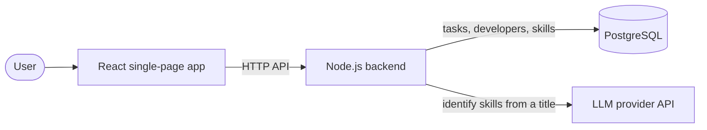
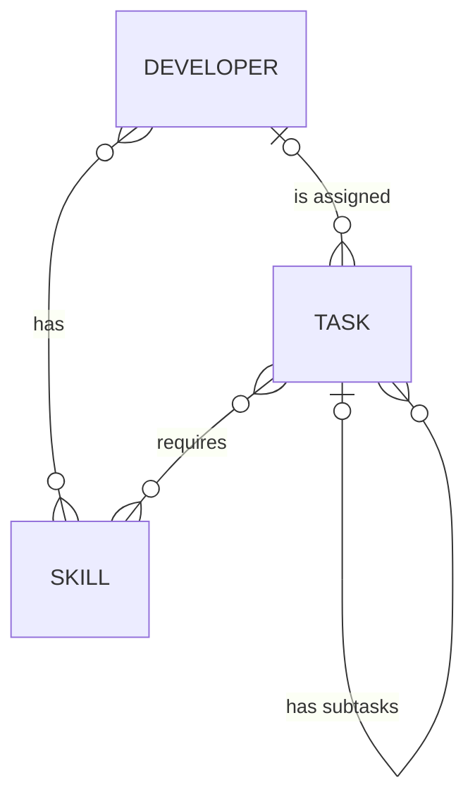
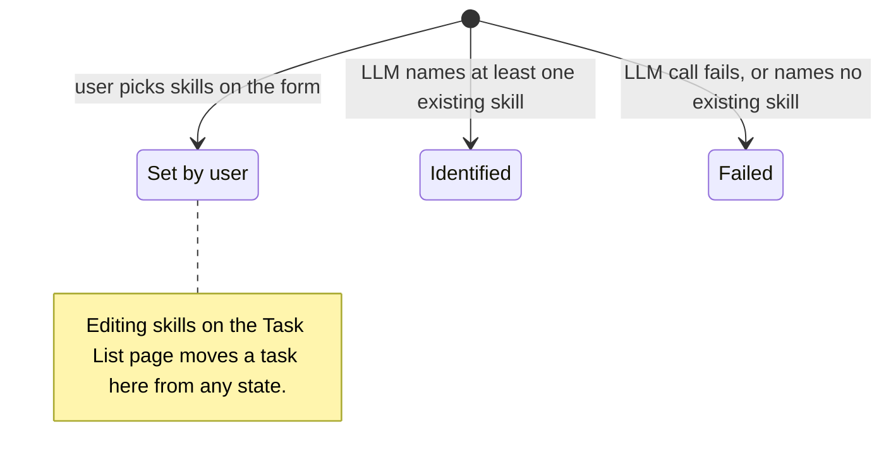

# Task Assignment App — Requirements

The Task Assignment app assigns tasks to developers by skill, tracks task status through nested subtasks, and uses an LLM to identify a task's skills when the user gives none.
This document restates the product brief and records the decisions this solution makes where the brief is silent, which the brief allows.

How to read it:

- A rule marked **Decision** is this solution's choice. Every unmarked rule restates the brief.
- [Assumptions](#assumptions) lists in one place how this solution reads the brief where it is silent or open to interpretation.
- The extra API operations, Out of scope and Possible follow-ups are all decisions.
- [Brief coverage](#brief-coverage) at the end maps each part of the brief to the section that covers it.

## Overview

The system has four parts: a React single-page app, a Node.js backend, a PostgreSQL database and an external LLM.



What the app does, mixing the brief with this solution's decisions:

| Area | Behaviour |
| --- | --- |
| Assignment | A task can go only to a developer who has every skill the task requires. |
| Status | Tasks move between To-do, In Progress, Blocked and Done. A task can be Done only when all its subtasks are Done. |
| Subtasks | A task can have subtasks, up to 3 levels in total. |
| Skill identification | When a task is saved without skills, an LLM identifies them before the save completes. If the LLM fails or names no skill, the task is still saved and a user picks its skills. |
| Pages | A Task List page to assign and update tasks, and a Task Creation page to build a task with its subtasks. |
| Packaging | The full stack runs with docker-compose. |

## Assumptions

The brief allows assumptions for anything it does not specify. These are the ones this solution makes about what the brief means; each links to the rule that applies it.

| Assumption | Why | Rule |
| --- | --- | --- |
| A developer must have **every** skill a task requires, not just one. | "The Skill(s) required by the Task" reads as all of them; a Frontend + Backend task needs both. | [Assignment](#assignment) |
| A task needs at least one skill before it can be assigned. | Otherwise any developer would qualify for a task with no skills, and the assignment rule would mean nothing. | [Assignment](#assignment) |
| A task has at most one assignee, and the assignee can be cleared. | The wireframe has one assignee dropdown per task, and shows unassigned tasks. | [Assignment](#assignment) |
| The statuses are To-do, In Progress, Blocked and Done, and any change is allowed except where the Done rule blocks it. | The brief gives "To-do", "Done", etc.; the extra two are common, Jira-style states. | [Status](#status) |
| Nesting stops at 3 levels in total. | The wireframe shows 3 levels; a limit keeps the first version simple. | [Subtasks](#subtasks) |
| Reopening a subtask under a Done parent moves the Done tasks above it back to In Progress. | The brief only covers moving *to* Done; this keeps a Done task from sitting above unfinished work. | [Subtasks](#subtasks) |
| Subtasks are created only with their parent, on the creation page. | The brief describes subtask creation only on the creation page. | [Subtasks](#subtasks) |
| The LLM can fail or find no matching skill; a person then picks the skills. | An external call can fail, and some titles match no existing skill. | [Skill identification](#skill-identification) |
| The LLM may only choose from the existing skills. | Skills are seeded data, and developers can only match skills that exist. | [Skill identification](#skill-identification) |
| "Create a PostgreSQL database that supports the following entities and business logic" (brief 1.1) means the schema stores what the rules need, and the backend enforces them. | Keeps business rules in one place, with clear errors, and out of the database. | [Where the rules are enforced](#where-the-rules-are-enforced) |
| The app is the only writer to the database. | No other system or admin path is described in the brief. | [Out of scope](#out-of-scope) |
| One user, with no login. | The brief never mentions users or authentication. | [Out of scope](#out-of-scope) |
| Only developers and skills are seeded, not tasks. | The brief's seed list names only those two. | [Domain model](#domain-model) |

## Stack

| Layer | Technology |
| --- | --- |
| Frontend | TypeScript and React (or a React framework), as a single-page app |
| Backend | TypeScript and Node.js (or a Node.js framework) |
| Database | PostgreSQL |
| LLM | Any provider with an API, such as Gemini |
| Packaging | Docker and docker-compose |

Additional libraries and dependencies may be used as needed.

## Domain model

A conceptual model of the entities. It includes two decisions: a task has at most one assignee (see Assignment) and at most one parent (see Where the rules are enforced).



- **Developer:** has a name and can have skills, such as Frontend, Backend, or both. A developer can be assigned tasks.
- **Skill:** a named capability. Many developers can share the same skill.
- **Task:** has a title and a status, and can require skills.
- **Subtask:** a task with a parent task, with the same properties as any task.

The database is seeded with these developers and skills. **Decision:** no tasks are seeded.

| Developer | Skills |
| --- | --- |
| Alice | Frontend |
| Bob | Backend |
| Carol | Frontend, Backend |
| Dave | Backend |

## Business rules

### Assignment

- A task can be assigned only to a developer who has the skills the task requires.
- **Decision:** the developer must have **every** required skill. For example, a Frontend + Backend task can go only to Carol.
- **Decision:** a task must have at least one skill before it can be assigned. A task the LLM could not classify cannot be assigned until a user picks its skills.
- **Decision:** the backend checks every assignment, on the creation form or the Task List page. The frontend's filtered dropdowns are a convenience, not the guard.
- **Decision:** a task has at most one assignee, and the assignee can be cleared. The brief's wireframe shows one assignee dropdown per task.

### Status

- A task has a status, such as "To-do" or "Done", and the status can be changed.
- **Decision:** the statuses are **To-do, In Progress, Blocked and Done**. Every new task starts as To-do, and the creation form has no status field.
- **Decision:** any status can change to any other, except where the subtask rules below prevent it.

### Subtasks

- A task can have subtasks, each with the same properties as a task, and subtasks can be nested.
- A task can change to **Done** only when all its subtasks are Done.
- **Decision:** nesting is limited to **3 levels in total**: a top-level task, its subtasks, and their subtasks. The backend rejects a deeper tree. This keeps the first version simple; the limit is one setting and can be raised later.
- **Decision:** if a subtask moves out of Done while its parent is Done, each Done task above it moves back to In Progress, and the user is told which tasks changed.
  For example, reopening "Avatar UI" while its parent "Profile update" is Done moves "Profile update" to In Progress.
- **Decision:** a task gets its subtasks only when it is created. Adding a subtask later, or moving a task under another, is not supported.

Two other decisions support these rules: new tasks start as To-do (see Status), and changes run in locked transactions (see Non-functional requirements). Together they mean a Done task never sits above unfinished work. That is why checking a task's direct subtasks is enough to enforce the Done rule at every level.

### Skill identification

- When a task or subtask is created without user-specified skills, the backend uses an LLM, through its API, to identify the skills from the task title. The user does not need to trigger this from the frontend.
- **Decision:** this happens while the Save request is open. The backend sends every title in the tree that has no skills to the LLM in one call, then saves the whole tree with the results in one transaction. The LLM call finishes before that transaction opens, so no database lock is held while waiting.
- **Decision:** creating a task never fails because of the LLM. Each attempt has a time limit, and a failed attempt is retried once, unless the error means the request, key or model is wrong, so Save waits at most twice the limit. If both attempts fail, those tasks are saved with their skills marked **failed**.
- **Decision:** the LLM may only choose from the existing skills, and any other name is ignored. A task the answer leaves out, or for which it names no existing skill, is marked failed.
- **Decision:** the time limit defaults to 20 seconds and is set by configuration. The default comes from four live Saves. The first call after the API starts took 9.3 seconds in one run. In another, a 10-second limit cut it off and the retry took 8 seconds. Later calls took about 1 second. Each attempt's response time is logged. If the wait on Save becomes a bottleneck, identification can move to a background job (see Possible follow-ups).
- **Decision:** the brief says skills "will be automatically generated". The failed state is a deliberate departure from that: when the LLM cannot help, a person picks the skills (see Editing skills).

When a task is saved, its skills end up in one of three states:



The brief's examples of the expected behaviour:

| Task title | Identified skills |
| --- | --- |
| As a visitor, I want to see a responsive homepage so that I can easily navigate on both desktop and mobile devices. | Frontend |
| As a system administrator, I want audit logs of all data access and modifications so that I can ensure compliance with data protection regulations and investigate any security incidents. | Backend |
| As a logged-in user, I want to update my profile information and upload a profile picture so that my account details are accurate and personalized. | Frontend, Backend |

### Editing skills

- **Decision:** a user can edit any task's skills from the Task List page, to correct a wrong LLM answer or to classify a failed task.
  For example, "Write onboarding docs" matches neither Frontend nor Backend, so a person has to pick its skills.
- **Decision:** an edit must leave at least one skill.
- **Decision:** if the current assignee lacks a new skill, the user is asked to confirm before saving, for example "Alice lacks Backend. Save and unassign Alice?" On confirm, the skills are saved and the assignee is cleared in one step. Without that confirmation the edit is rejected, so the assignment rule always holds and no assignment is lost unseen. This trades a strict rejection for less friction: correcting a label takes one deliberate action, not unassign, edit and reassign.
- **Decision:** the tool never keeps an assignee who lacks a required skill, even if the user would accept it. The brief makes "a task can only be assigned to a developer with the skills it requires" a hard rule (parts 1.1 and 2.1). The user stays in control of which skills a task needs and who takes it next; the tool only refuses to save a forbidden state.

## Where the rules are enforced

- A PostgreSQL database supports the entities, their business logic, and subtasks.
- **Decision:** the schema stores everything the business rules need, and the backend owns the rules themselves. This is how this solution reads "supports".
  - The database guards integrity only: rows link to rows that exist, required fields are present, and a task has at most one parent and one assignee.
  - The backend checks every business rule, including the assignment rule, the Done rule, the allowed statuses and the nesting limit. It returns an error that names the broken rule, and changing a rule never needs a database migration.
  - The backend runs its checks inside locked database transactions (see Non-functional requirements). The database provides safe concurrency, not the rules.

## Pages

The app is a single-page application with two pages.

### Task List page

- Lists all existing tasks with their relevant attributes. A task can be assigned to a developer with the required skills, and its status can be updated.
- **Decision:** subtasks are indented under their parent, and each parent can be expanded or collapsed.
- **Decision:** every row, top-level or subtask, has its own status and assignee dropdowns. The assignee dropdown lists only qualifying developers, plus an empty choice to unassign.
- **Decision:** the Done choice is disabled while a task has unfinished subtasks, and the row says why. A parent row shows subtask progress, for example "2/3 done".
- **Decision:** each task shows where its skills came from: set by a user, identified by the LLM, or failed. A failed task is labelled "Skills needed", not "Failed", so it is not mistaken for a status, and it prompts the user to pick its skills.

The brief's wireframe, titled "Tasks", copied as text. `[To-do ▾]` and `[Alice ▾]` are dropdowns, and `[ ▾]` is an empty one. The brief does not explain the "…" column; this solution reads it as room for more columns.

| Task Title | Skills | … | Status | Assignee |
| --- | --- | --- | --- | --- |
| As a visitor, I want to see a responsive homepage so that I can easily navigate on both desktop and mobile devices. | Frontend | | `[To-do ▾]` | `[Alice ▾]` |
| As a system administrator, I want audit logs of all data access and modifications so that I can ensure compliance with data protection regulations and investigate any security incidents. | Backend | | `[To-do ▾]` | `[      ▾]` |
| As a logged-in user, I want to update my profile information and upload a profile picture so that my account details are accurate and personalized. | Frontend, Backend | | `[To-do ▾]` | `[      ▾]` |

### Task Creation page

- A new task is created by submitting a form. The user can specify the skills the task requires, and does not need to assign a developer.
- The page supports creating subtasks and nested subtasks. Each subtask is an additional React component, rendered dynamically on the same page and indented one level further.
- **Decision:** one form creates one top-level task and its subtasks, and saving stores the whole tree in one step. If any part is invalid, nothing is saved.
- **Decision:** one tree holds at most **50 tasks**, the top-level task included. The backend rejects a larger tree, and the form stops offering "Add Subtask" at the limit. The limit keeps an oversized request from failing deep in the system; 50 is far above any realistic tree.
- **Decision:** "Add Subtask" is hidden on a third-level task, to enforce the nesting limit. The brief's wireframe shows the button on every component, so this is a deliberate departure.
- **Decision:** the assignee picker is enabled only after the user picks skills for that task, and lists only developers who have all of them. A task left to the LLM is assigned later, from the Task List page.
  The backend rejects a create request that names an assignee for a task without user-picked skills as invalid input, before calling the LLM.

The brief's wireframe for nested subtasks, copied as text. It extends a simpler first version titled "Create Task", which has a single "New Task Component" and a Save button. In this solution, components 1.1.1 and 1.1.2 have no "Add Subtask" button.

```text
┌──────────────────────────────────────────────────────────────────┐
│ Create Task(s)                                                   │
│                                                                  │
│ ┌╌╌╌╌╌╌╌╌╌╌╌╌╌╌╌╌╌╌╌╌╌╌╌╌╌╌╌╌╌╌╌╌╌╌╌╌╌╌╌╌╌╌╌╌╌╌╌╌╌╌╌╌╌╌╌╌╌╌╌╌╌╌┐ │
│ ┆          New Task Component 1               [ Add Subtask ]  ┆ │
│ └╌╌╌╌╌╌╌╌╌╌╌╌╌╌╌╌╌╌╌╌╌╌╌╌╌╌╌╌╌╌╌╌╌╌╌╌╌╌╌╌╌╌╌╌╌╌╌╌╌╌╌╌╌╌╌╌╌╌╌╌╌╌┘ │
│   ┌╌╌╌╌╌╌╌╌╌╌╌╌╌╌╌╌╌╌╌╌╌╌╌╌╌╌╌╌╌╌╌╌╌╌╌╌╌╌╌╌╌╌╌╌╌╌╌╌╌╌╌╌╌╌╌╌╌╌╌╌┐ │
│   ┆        New Task Component 1.1             [ Add Subtask ]  ┆ │
│   └╌╌╌╌╌╌╌╌╌╌╌╌╌╌╌╌╌╌╌╌╌╌╌╌╌╌╌╌╌╌╌╌╌╌╌╌╌╌╌╌╌╌╌╌╌╌╌╌╌╌╌╌╌╌╌╌╌╌╌╌┘ │
│     ┌╌╌╌╌╌╌╌╌╌╌╌╌╌╌╌╌╌╌╌╌╌╌╌╌╌╌╌╌╌╌╌╌╌╌╌╌╌╌╌╌╌╌╌╌╌╌╌╌╌╌╌╌╌╌╌╌╌╌┐ │
│     ┆      New Task Component 1.1.1           [ Add Subtask ]  ┆ │
│     └╌╌╌╌╌╌╌╌╌╌╌╌╌╌╌╌╌╌╌╌╌╌╌╌╌╌╌╌╌╌╌╌╌╌╌╌╌╌╌╌╌╌╌╌╌╌╌╌╌╌╌╌╌╌╌╌╌╌┘ │
│     ┌╌╌╌╌╌╌╌╌╌╌╌╌╌╌╌╌╌╌╌╌╌╌╌╌╌╌╌╌╌╌╌╌╌╌╌╌╌╌╌╌╌╌╌╌╌╌╌╌╌╌╌╌╌╌╌╌╌╌┐ │
│     ┆      New Task Component 1.1.2           [ Add Subtask ]  ┆ │
│     └╌╌╌╌╌╌╌╌╌╌╌╌╌╌╌╌╌╌╌╌╌╌╌╌╌╌╌╌╌╌╌╌╌╌╌╌╌╌╌╌╌╌╌╌╌╌╌╌╌╌╌╌╌╌╌╌╌╌┘ │
│                                                       [ Save ]   │
└──────────────────────────────────────────────────────────────────┘
```

## API operations

The brief requires: create a task; read a task with all its relevant properties; assign a task, enforcing the assignment rule; change a task's status; read a developer with all their relevant properties; and read a skill with all its relevant properties.
Listing tasks, developers and skills, and updating a task's skills, go beyond the brief because the pages need them.

| Entity | Operations |
| --- | --- |
| Task | Create a task with its subtasks; read a task with all its properties; list tasks; update the assignee, status or skills |
| Developer | Read a developer with their skills and assigned tasks; list developers |
| Skill | Read a skill with its properties; list skills |

## Non-functional requirements

- **Code quality:** the solution follows software engineering best practices and keeps code quality high.
- **Runs in containers:** the entire solution, including all dependencies, is containerized with Docker. docker-compose runs a fully working app: frontend, backend, database with seed data, and LLM integration.
  **Decision:** the compose file works with both `docker-compose` and the newer `docker compose`.
- **Decision, consistent under concurrent updates:** every status change, assignee change and skill change runs in one database transaction.
  - It locks the tree's top-level task first, then the task being changed, then any developer it checks. Every change in a tree takes the same first lock, so changes to one tree run one after another and cannot deadlock.
  - A reopened subtask and the resetting of the Done tasks above it happen in the same transaction.
  - So two concurrent requests cannot both pass their checks. For example, marking "Profile update" Done while its subtask "Avatar UI" is reopened cannot leave a Done task above an unfinished one.
- **Decision, secrets stay out of the repository:** the LLM API key is read from an environment file, and the repository carries only an example of that file.
- **Decision, tested:** automated tests cover the assignment rule, the subtask rules, nesting depth and LLM response handling, including API tests against a real PostgreSQL database.
- **Documented:** the README explains how to configure and run the app, the system design, the API, and the justification for the libraries and dependencies used.
  **Decision:** it also explains which rules the backend enforces, which the database guards, and why.

## Out of scope

- Authentication and user accounts.
- Pagination.
- Deleting tasks or editing their titles.
- Adding subtasks to an existing task, or moving a task under another.
- Links between tasks, such as "related to".
- Adding, renaming or removing developers or skills themselves. Choosing a task's skills is in scope.
- Deployment beyond docker-compose.
- Guarding against direct database edits. The app is the only writer, so business rules such as the allowed statuses are checked only in the backend.

## Possible follow-ups

| Follow-up | What it would add |
| --- | --- |
| Status workflow | Limit which status changes are allowed, Jira-style. For example, To-do could move only to In Progress. |
| Drag-and-drop ordering | Let users reorder tasks to show priority, as Jira, Trello and Linear do. Subtasks already have a `position`, which a drag would renumber under the tree lock. Top-level tasks would need a rank column of their own, because today they sort by creation time. |
| Needs-reassignment view | List tasks that lost their assignee to a skill edit, so they get a new one. Needs the unassignment recorded, for example a reason column. A skill-mismatch report would always be empty, because the rule never lets a mismatch be saved. |
| Deeper nesting | Raise the nesting limit beyond 3 levels. |
| Background skill identification | Save returns at once, and a background job identifies skills afterwards. Worth it only if the LLM wait on Save becomes a bottleneck. |
| Migration tool | Versioned schema changes, needed once the schema changes after release. |
| Generated frontend types | Generate the frontend's API types from the backend's zod schemas, so they cannot drift. |

## Brief coverage

| Brief part | Covered in |
| --- | --- |
| Notes: assumptions allowed | Assumptions |
| Process notes (version control, tooling) | Not product requirements. |
| Background: best practices, code quality | Non-functional requirements |
| Overview: stack, extra libraries | Stack |
| 1.1 Entities and business logic | Domain model; Business rules; Where the rules are enforced |
| 1.2 Seed data | Domain model |
| 2.1 Backend API | API operations; Assignment; Status |
| 3.1 Task List page | Task List page |
| 3.1 Task Creation page | Task Creation page |
| 4.1 Subtasks in the schema | Subtasks; Where the rules are enforced |
| 4.2 Done rule | Subtasks |
| 4.3 Nested subtasks on the creation page | Task Creation page |
| 5.1 Skill identification and examples | Skill identification |
| 5.2 LLM integration through an API | Stack; Skill identification |
| 5.3 Automatic, backend-only trigger | Skill identification |
| 6.1, 6.2 Docker and docker-compose | Non-functional requirements |
| 7.1 README | Non-functional requirements |
| 7.1 Public repository; 7.2 | Not product requirements. |
